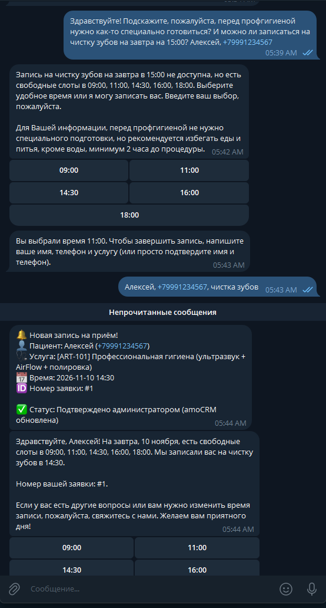
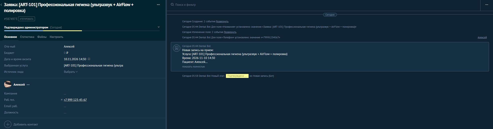
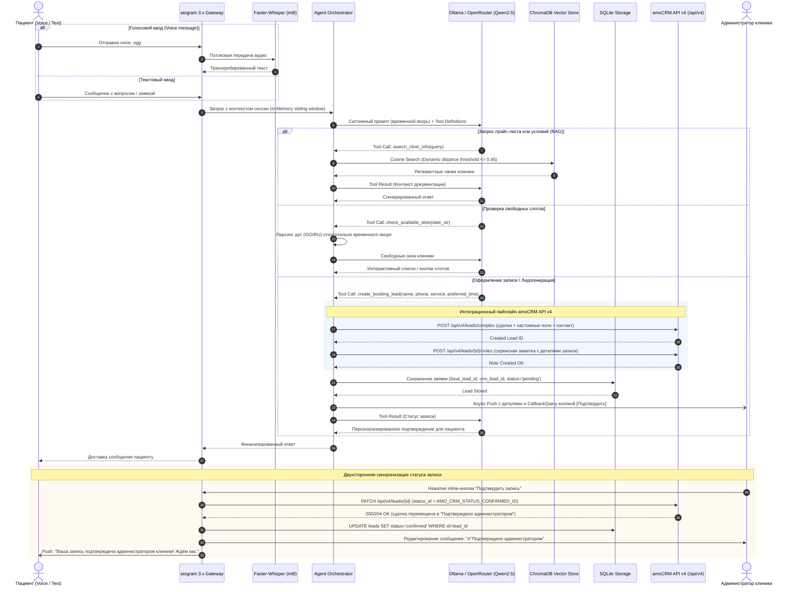

# DentaPlus AI Concierge — Production RAG, Speech-to-Text & amoCRM v4 Clinic Assistant

<p align="center">
  
  
  
  
  
  
  
  
</p>

---

## 📸 Витрина проекта (Showcase)

| Подтверждение записи в Telegram (Inline Actions) | Воронка amoCRM (Автопереход сделки) | Карточка сделки (Кастомные поля, таймлайн и заметки) |
| :---: | :---: | :---: |
|  |  |  |
| Инлайн-уведомление администратора в закрытом канале с кнопкой мгновенного подтверждения записи. | Сквозной пайплайн: автоматическое создание сделки и автопереход по этапам воронки продаж. | Полная синхронизация кастомных полей (услуга, время визита), фиксация контакта и сервисный аудит-лог в примечаниях. |

---

## 🏗 Архитектура системы

### Sequence Diagram сквозного взаимодействия компонентов и amoCRM v4



### Архитектурные решения (Design Decisions)

1. **Интеграция с amoCRM API v4 и двухсторонняя синхронизация**:
   - **Атомарное создание лида через `/api/v4/leads/complex`**: за один сетевой запрос создается сделка и ассоциированный контакт с типом телефона `WORK`, что минимизирует latency и предотвращает появление висячих сущностей без контакта.
   - **Сериализация кастомных полей**: поле желаемого времени визита конвертируется в целочисленный **Unix timestamp** (требование amoCRM для полей типа `date_time`), а наименование услуги связывается с кастомным текстовым полем.
   - **Аудит-след через `/api/v4/leads/{id}/notes`**: после успешного создания сделки автоматически прикрепляется сервисная заметка со сводкой записи (пациент, контактный телефон, выбранная услуга и слот).
   - **Двухсторонняя синхронизация статусов (Telegram ⇄ amoCRM ⇄ SQLite)**: при подтверждении записи администратором через inline-кнопку в Telegram шлюз выполняет асинхронный HTTP PATCH-запрос в amoCRM, перемещая сделку на этап *«Подтверждено администратором»*, актуализирует статус в локальной БД SQLite и отправляет клиенту push-уведомление.

2. **Паттерн `BaseCRMClient` и безопасное тестирование**:
   - Архитектура CRM-модуля спроектирована по принципу инверсии зависимостей (DIP): абстрактный интерфейс `BaseCRMClient` реализуется рабочим клиентом `AmoCRMClient` (на базе `httpx.AsyncClient`) и легковесным `MockCRMClient`.
   - Фабрика `get_crm_client()` автоматически инстанциирует `MockCRMClient`, если флаг `AMO_CRM_ENABLED=False` или не заданы боевые токены.
   - Это гарантирует полную изолированность и безопасность CI/CD пайплайнов и unit/integration тестов: тестовый контур выполняется без обращения к внешним веб-сервисам и без риска утечки боевых авторизационных токенов.

3. **Faster-Whisper (int8 CTranslate2) вместо Cloud STT**:
   - **Zero Latency & Zero Cost**: Локальный инференс модели Whisper на CPU с квантованием `int8` транскрибирует 10-секундное голосовое сообщение менее чем за ~250–400 мс без сетевых издержек и тарификации за минуту внешних API.
   - **GDPR / 152-ФЗ Compliance**: Голосовые биометрические данные пациентов не покидают периметр закрытой инфраструктуры клиники.

4. **ChromaDB с динамическим порогом дистанции (Dynamic Distance Threshold)**:
   - Векторный поиск использует косинусное расстояние с порогом `distance <= 0.45` (конфигурируемый `RAG_DISTANCE_THRESHOLD`).
   - Если релевантные чанки не преодолевают порог достоверности, контекст отсекается, исключая галлюцинации модели: агент честно сообщает об отсутствии точной информации и предлагает связаться с регистратурой вместо выдумывания стоимости процедур.

5. **Строгий Function Calling и устойчивость к датам (временной якорь)**:
   - JSON-схема инструментов строго валидируется на уровне вызова функций LLM (`create_booking_lead`, `check_available_slots`).
   - В системный промпт инжектируется жесткий **временной якорь** (текущие дата и день недели). Все относительные формулировки пациента (*«на завтра»*, *«в следующий четверг»*, даты вида `15.11` без года) детерминированно преобразуются в валидные календарные даты с валидацией недопустимости прошедшего времени.

---

## 🛠 Технологический стек

| Компонент | Технология | Назначение |
| :--- | :--- | :--- |
| **Runtime & Language** | Python 3.11+ | Базовая платформа: строгая типизация, TaskGroup, повышенная производительность |
| **CRM Integration** | amoCRM API v4, httpx | Асинхронная двухсторонняя интеграция: `/api/v4/leads/complex`, `/notes`, статус-патчи |
| **Bot Gateway** | aiogram 3.x | Асинхронный event-driven шлюз Telegram на Router, FSM и CallbackQuery |
| **Speech-to-Text** | Faster-Whisper (CTranslate2) | Локальное интуит-квантованное (`int8`) распознавание голосовых сообщений |
| **LLM Inference** | Ollama / OpenRouter API | Выполнение системных рассуждений и Function Calling (Qwen 2.5 7B / Llama 3.1) |
| **Vector Database** | ChromaDB Persistent | Векторное эмбеддинг-хранилище прайс-листов, регламентов и клинических протоколов |
| **Embeddings** | HuggingFace / FastEmbed | Локальная генерация плотных векторов для семантического поиска |
| **Relational Storage** | SQLite / aiosqlite | Транзакционное хранение лидов, связка с `crm_lead_id` и аудит-логов |
| **Validation & Schema** | Pydantic v2 | Контрактная валидация payload вызовов инструментов и настроек окружения |
| **Packaging & Isolation**| Docker & Docker Compose | Контейнеризация сервиса с интеграцией локального окружения |
| **Quality & Tests** | Ruff, Mypy, Pytest-asyncio | Статический анализ, строгая типизация и 73 асинхронных теста с моками API |

---

## ⚡ Инженерные особенности (Key Highlights for Tech Leads)

- **Комплексная синхронизация с amoCRM API v4**:
  - Создание сделки с контактными данными и кастомными полями через единый запрос `/api/v4/leads/complex`.
  - Преобразование слота записи в Unix timestamp для строгих полей даты/времени amoCRM.
  - Автоматическое добавление структурированных примечаний (`/notes`) к сделке.
  - Двухстороннее обновление статуса: подтверждение администратором в Telegram мгновенно меняет этап воронки в amoCRM.
- **Временной якорь и устойчивость к датам**:
  - Автоматическое определение текущей даты и расчет относительных дат (*«на послезавтра»*, *«в следующую среду»*).
  - Защита от бронирования в прошлое и валидация рабочих дней недели.
- **Двухуровневый Fallback & Circuit Breaker**:
  - При недоступности основного локального инференса Ollama трафик прозрачно деградирует на резервный fallback-провайдер без прерывания пользовательского сеанса.
  - При таймаутах векторного хранилища ChromaDB агент изолирует RAG-пайплайн и переключается в режим безопасного сбора контактов регистратуры.
- **Безопасность и строгий RBAC**:
  - Telegram User ID валидируются через фильтры авторизации на уровне middleware роутера.
  - Административные команды (`/leads`, экспорт данных в XLSX) изолированы белым списком `ADMIN_USER_IDS`. Экспорт персональных данных шифруется и логируется в аудит-трейле.
- **Docker Healthcheck & Active Dependency Monitoring**:
  - Контейнер сконфигурирован с фоновым healthcheck-зондом, проверяющим доступность upstream-портов и коннективность LLM/Vector DB.
  - Политика `restart: unless-stopped` с автоматическим self-healing при сбоях I/O.
- **Высокое тестовое покрытие (73 теста, pytest-asyncio)**:
  - Набор unit/integration тестов на `pytest-asyncio` и `pytest-mock` с полным мокированием сетевых вызовов httpx, Ollama, Telegram API и amoCRM.
  - Включены стресс-тесты сетевых сбоев: имитация разрыва сокетов LLM, подделка некорректных tool arguments, сбои при отправке заметок amoCRM, симуляция поврежденных OGG-аудиопотоков.

---

## 🚀 Инструкция по развертыванию

### 1. Переменные окружения (.env.example)

Создайте файл `.env` на основе шаблона:

```bash
cp .env.example .env
```

```env
# Telegram Bot
BOT_TOKEN=123456789:ABCdefGHIjklMNOpqrsTUVwxyz

# LLM Provider
LLM_BASE_URL=http://host.docker.internal:11434/v1
LLM_API_KEY=ollama
LLM_MODEL=qwen2.5:7b

# Storage & RAG
CHROMA_PERSIST_DIR=/app/storage/chroma
SQLITE_DB_PATH=/app/storage/leads.db
TOP_K_RESULTS=3

# Agent Configuration
HISTORY_LIMIT=10
MAX_TOOL_TURNS=3

# Admin Access Control (comma-separated Telegram IDs)
ADMIN_USER_IDS=[123456789,987654321]

# amoCRM API v4 Integration
AMO_CRM_ENABLED=true
AMO_CRM_SUBDOMAIN=your_subdomain
AMO_CRM_ACCESS_TOKEN=your_long_lived_access_token
AMO_CRM_FIELD_VISIT_TIME_ID=1234567
AMO_CRM_FIELD_SERVICE_ID=1234569
AMO_CRM_STATUS_CONFIRMED_ID=12345678
```

### 2. Запуск через Docker Compose

Для взаимодействия контейнера с локальной Ollama используется шлюз `host.docker.internal`:

```bash
docker compose up -d --build
```

Просмотр логов:
```bash
docker compose logs -f app
```

### 3. Локальная разработка

```bash
# Установка зависимостей и линтеров
make install

# Запуск линтинга и проверки типов
make lint

# Прогон тестов (73 pytest-asyncio тестов)
make test

# Запуск приложения в Docker
make up
```
